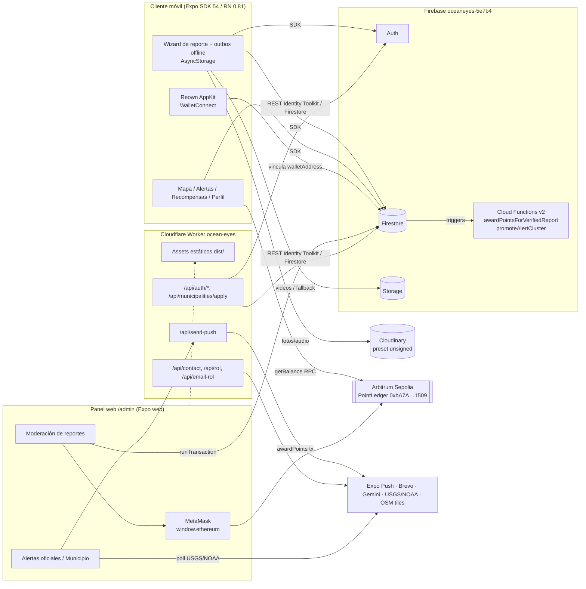
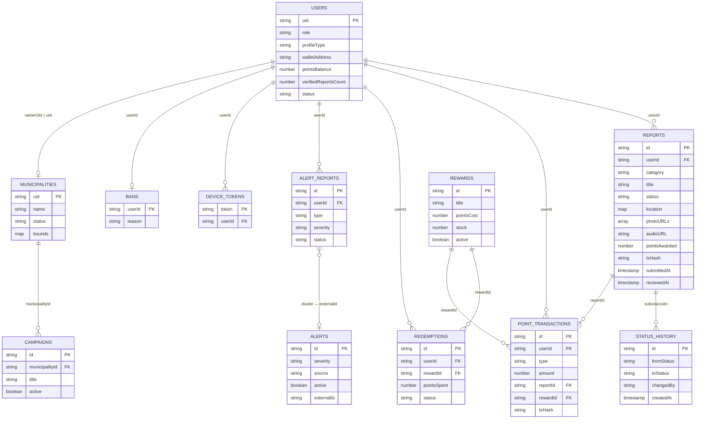

# Insumos del sistema OceanEyes para el informe académico

> Auditoría técnica sobre el repositorio `OceanEyesAPP`, rama `main` (HEAD `9f533c6`, 2026-10-08).
> Fecha de extracción: 2026-11-11. Todas las cifras salen de comandos ejecutados en esta auditoría
> o de archivos del repositorio citados con ruta. "NO ENCONTRADO" indica que el dato no existe en el repo.

---

## 1. Inventario del proyecto

### 1.1 Árbol (2 niveles, solo archivos versionados)

| Ruta | Contenido |
|---|---|
| `src/app/` (55 archivos) | Rutas Expo Router: `(landing)/`, `mobile/`, `admin/`, `api/` (+api routes de desarrollo) |
| `src/mobile/` (215) | App móvil: `modules/{alerts,auth,home,profile,reports,rewards}`, `shared/{firebase,offline,blockchain,notifications,identity,…}` |
| `src/admin/` (53) | Panel web: `config/`, `layout/`, `presentation/{screens,sections,components,hooks}`, `theme/` |
| `src/landing/` (47) | Landing web pública |
| `src/shared/` (20) | `blockchain/` (PointLedger), `gateway/` (registro municipal), `rol/` (quiz Gemini), `styles/` |
| `src/worker.ts` | Cloudflare Worker (API + assets estáticos) |
| `functions/src/index.ts` | Cloud Functions v2 |
| `contracts/` | Hardhat: `contracts/PointLedger.sol`, `test/` (2), `scripts/` (2) |
| `docs/` | 11 documentos .md + `images/` |
| `scripts/` | `create-cloudinary-preset.sh`, `fix-assets.cjs`, `reset-project.js` |
| `plugins/` | `with-google-maps-api-key.js` (config plugin) |
| `assets/` | iconos, imágenes, `sounds/alarma_peligro.wav` |
| `public/`, `dist/` | `arquitectura.html` |
| Raíz | `app.json`, `app.config.js`, `eas.json`, `wrangler.toml`, `firebase.json`, `firestore.rules`, `firestore.indexes.json`, `storage.rules`, `tsconfig.json`, `eslint.config.js`, `.env.example` |

Creado en esta auditoría (no existía): `__tests__/`, `load-tests/`, `scripts/kpi_export.js`, `.github/workflows/ci.yml`, este informe.

### 1.2 `package.json` (raíz)

| Script | Comando |
|---|---|
| `start` | `expo start` |
| `build:apk` | `eas build -p android --profile preview` |
| `android` / `ios` | `expo run:android` / `expo run:ios` |
| `web` | `expo start --web` |
| `deploy:web` | `expo export --platform web && node scripts/fix-assets.cjs && npx wrangler deploy` |
| `lint` | `expo lint` |
| `test` | NO ENCONTRADO en `main` (existe en la rama `capstone-upn-test`, ver §6.2) |

| Dependencia principal | Versión declarada | Instalada |
|---|---|---|
| expo | ^54.0.0 | 54.0.37 |
| react-native | 0.81.5 | 0.81.5 |
| react / react-dom | 19.1.0 | 19.1.0 |
| expo-router | ~6.0.24 | 6.0.24 |
| firebase (JS SDK) | ^12.17.0 | — |
| ethers | ^6.17.0 | — |
| @reown/appkit-react-native / -ethers-react-native | ^2.0.6 | — |
| @walletconnect/react-native-compat | ^2.23.10 | — |
| react-native-maps | 1.20.1 | — |
| leaflet | ^1.9.4 | — |
| expo-notifications | ~0.32.17 | — |
| expo-camera / expo-image-picker / expo-audio / expo-location | ~17.0.10 / ~17.0.11 / ~1.1.1 / ~19.0.8 | — |
| @react-native-async-storage/async-storage | 2.2.0 | — |
| @react-native-google-signin/google-signin | ^16.1.4 | — |
| typescript (dev) | ~5.9.2 | — |
| eslint (dev) / eslint-config-expo | ^9.0.0 / ~10.0.0 | — |

`functions/package.json`: `firebase-admin ^13.0.0`, `firebase-functions ^6.0.0`, `engines.node = 22`.
`contracts/package.json`: `hardhat ^2.22.19`, `@nomicfoundation/hardhat-toolbox ^5.0.0`, `@openzeppelin/contracts ^5.6.1`, `ethers ^6.13.0`.

### 1.3 Configuración de build y despliegue

| Archivo | Contenido relevante |
|---|---|
| `app.json` | name `OceanEyes`, scheme `oceaneyes`, `android.package`/`ios.bundleIdentifier` = `com.belze.oceaneyesapp`, `web.output: static`, `experiments.typedRoutes` y `reactCompiler` = true; plugins: expo-router, expo-camera, expo-splash-screen, expo-video, expo-location, expo-audio, expo-notifications (canal `oceaneyes`, sonido `alarma_peligro.wav`), expo-image-picker, expo-media-library; 12 permisos Android (cámara, ubicación fina/gruesa, audio, media, notificaciones…) |
| `app.config.js` | Añade Google Sign-In solo si existe `EXPO_PUBLIC_GOOGLE_IOS_CLIENT_ID`; plugin `with-google-maps-api-key`; `owner: solvegrades`; EAS `projectId: 2d52637a-7a67-4895-b090-af2792925e6b` |
| `eas.json` | CLI `>= 24.11.0`, `appVersionSource: remote`; perfiles `development` (dev client, internal, APK), `preview` (internal, APK), `production` |
| `wrangler.toml` | Worker `ocean-eyes`, `main = src/worker.ts`, `compatibility_date = 2026-08-07`, assets `./dist` (binding `ASSETS`), vars `FIREBASE_API_KEY` (AIza…), `FIREBASE_PROJECT_ID = oceaneyes-5e7b4` |
| `firebase.json` | functions (`functions/`), firestore (rules + indexes), storage (rules), emuladores auth 9099 / firestore 8080 / storage 9199 / UI 4000 |
| `contracts/hardhat.config.js` | Solidity 0.8.24, optimizer 200 runs; red `arbitrumSepolia` chainId 421614 (RPC `ARBITRUM_SEPOLIA_RPC_URL` o público), cuentas desde `PRIVATE_KEY` (.env); verificación vía Etherscan API V2 |
| `firestore.indexes.json` | 9 índices compuestos (reports ×3, alerts ×2, campaigns ×2, redemptions ×1, alertReports ×1) |

### 1.4 Versiones de plataforma

| Ítem | Valor | Fuente |
|---|---|---|
| Expo SDK | 54 (54.0.37 instalado) | `package.json`, `node_modules/expo/package.json` |
| React Native | 0.81.5 | `package.json` |
| Node requerida | App: NO ENCONTRADO `engines` en `package.json` raíz (README: "Node.js ≥ 20"); Functions: `22` (`functions/package.json`) | — |
| Android minSdk / targetSdk / compileSdk | 24 / 36 / 36 — no fijados en el repo (no hay `expo-build-properties` ni `/android`); son los valores por defecto de RN 0.81 | `node_modules/react-native/gradle/libs.versions.toml` |
| iOS deploymentTarget | 15.1 — no fijado en el repo; valor por defecto de RN 0.81 | `node_modules/react-native/scripts/cocoapods/helpers.rb` (`min_ios_version_supported`) |

---

## 2. Arquitectura real

### 2.1 Módulos y pantallas

**App móvil** (`/mobile`, tabs `inicio · reportes · recompensas · perfil` en `src/mobile/shared/config/main-tabs.ts`)

| Ruta | Pantalla / módulo |
|---|---|
| `/mobile` | `src/mobile/modules/home/presentation/screens/home-screen.tsx` (secciones `home-section`, `reports-section`, `rewards-section`, `profile-section`) |
| `/mobile/login` | `src/mobile/modules/auth/presentation/screens/mobile-login-screen.tsx` + `viewmodels/login.viewmodel.ts` |
| `/mobile/report` | `src/mobile/modules/reports/presentation/screens/report-create-screen.tsx` (wizard 5 pasos) |
| `/mobile/map` | `src/mobile/modules/home/presentation/screens/map-screen.tsx` |
| `/mobile/alerts` | `src/mobile/modules/alerts/presentation/screens/alerts-screen.tsx` |
| `/mobile/alert-report` | `src/mobile/modules/alerts/presentation/screens/alert-report-screen.tsx` |
| `/mobile/recent-activity` | `src/mobile/modules/rewards/presentation/screens/recent-activity-screen.tsx` |
| `/mobile/settings` | `src/mobile/modules/profile/presentation/screens/settings-screen.tsx` |
| `/mobile/edit-profile` | `src/mobile/modules/profile/presentation/screens/edit-profile-screen.tsx` |
| `/mobile/change-password` | `src/mobile/modules/profile/presentation/screens/change-password-screen.tsx` |
| `/mobile/legal` | `src/mobile/modules/profile/presentation/screens/legal-screen.tsx` |

Los módulos `alerts`, `auth`, `home`, `profile`, `rewards` tienen carpetas hexagonales (`domain/`, `application/`, `infrastructure/`) vacías (`.gitkeep`). Solo `reports` implementa puertos y adaptadores (`src/mobile/modules/reports/{domain,application,infrastructure}`).

**Panel web** (`/admin`, solo web; guarda de rol en `src/app/admin/_layout.tsx`)

| Ruta | Pantalla | Rol |
|---|---|---|
| `/admin/login` | `src/admin/presentation/screens/admin-login-screen.tsx` | público |
| `/admin` | `dashboard-screen.tsx` | admin |
| `/admin/reports`, `/admin/reports/[id]` | `reports-screen.tsx`, `report-detail-screen.tsx` | admin |
| `/admin/mapa` | `reports-map-screen.tsx` | admin |
| `/admin/users`, `/admin/users/[id]`, `/admin/users/new` | `users-screen.tsx`, `user-profile-screen.tsx`, `users-new-screen.tsx` | admin |
| `/admin/bans` | `bans-screen.tsx` | admin |
| `/admin/rewards`, `/[id]`, `/[id]/edit`, `/new` | `rewards-screen.tsx`, `reward-view-screen.tsx`, `rewards-edit-screen.tsx`, `rewards-new-screen.tsx` | admin |
| `/admin/redemptions`, `/admin/redemptions/[id]` | `redemptions-screen.tsx` | admin |
| `/admin/alerts` | `alerts-screen.tsx` | admin |
| `/admin/municipalities` | `municipalities-screen.tsx` | admin |
| `/admin/municipio`, `/municipio/{reportes,alertas,campanas}`, `/municipio/reports/[id]` | `municipality-dashboard-screen.tsx`, `report-detail-screen.tsx` (readOnly) | municipal |

**Landing web** (`src/app/(landing)/`): inicio, `arbitrum`, `contacto`, `descargas`, `descubre-tu-rol`, `faq`, `municipio`.

**API (Cloudflare Worker `src/worker.ts`)**: `POST /api/contact`, `/api/rol`, `/api/email-rol`, `/api/send-push`, `/api/auth/signup`, `/api/auth/delete`, `/api/municipalities/apply`; resto → assets estáticos.

### 2.2 Servicios externos y dónde se usan

| Servicio | Uso | Archivos |
|---|---|---|
| Firebase Auth | Email/contraseña, Google, anónimo (invitado), vinculación de cuentas | `src/mobile/shared/firebase/auth.ts`, `auth-context.tsx`, `auth-persistence(.native).ts`; REST Identity Toolkit en `src/shared/gateway/municipal-signup.ts` |
| Firestore | Todas las colecciones (§3) | `src/mobile/shared/firebase/*.ts`, pantallas admin (`report-detail-screen.tsx`, `dashboard-charts/page.tsx`, …), REST en `municipal-signup.ts` |
| Firebase Storage | Fallback de medios y videos | `src/mobile/shared/offline/media.ts` (`uploadMediaToStorage`) |
| Cloud Functions | `awardPointsForVerifiedReport`, `promoteAlertCluster` | `functions/src/index.ts` |
| Cloudinary | Fotos y audio de reportes (preset unsigned `oceaneyes_reports`); imágenes de landing | `src/mobile/shared/offline/cloudinary.ts`, `scripts/create-cloudinary-preset.sh`, `src/landing/**` |
| Google Maps | Mapas nativos (react-native-maps) con API key vía config plugin | `plugins/with-google-maps-api-key.js`, `real-time-map.native.tsx`, `location-step-map.native.tsx`, `territory-map.tsx` |
| Geocoding | NO ENCONTRADO (`grep reverseGeocode/geocode` sin resultados en `src/`) | — |
| Leaflet + OpenStreetMap tiles | Mapas web | `real-time-map.web.tsx`, `report-map.web.tsx`, `territory-map.web.tsx` |
| Notificaciones | Expo Push (token en `deviceTokens`, envío por Worker `/api/send-push`) + notificaciones locales por snapshot | `src/mobile/shared/notifications/report-notifications.tsx`, `src/mobile/shared/firebase/device-tokens.ts`, `src/worker.ts`, `alerts-screen.tsx` |
| ethers v6 | Lectura de saldo on-chain, `awardPoints` firmado con MetaMask | `src/shared/blockchain/{ledger,wallet,config}.ts`, `src/admin/presentation/hooks/useWallet.tsx`, `src/mobile/shared/firebase/reports.ts` |
| Reown AppKit / WalletConnect | Vinculación de wallet en la app móvil | `src/mobile/shared/blockchain/appkit*.tsx`, `profile-section.tsx` |
| viem | NO ENCONTRADO | — |
| USGS / NOAA (weather.gov) | Ingesta de alertas externas (poller en el header admin) | `src/mobile/shared/adapters/external-alerts/*`, `src/admin/layout/header/admin-header.tsx` |
| Google Gemini | Quiz "Descubre tu rol" (solo servidor) | `src/shared/rol/gemini.ts`, `src/worker.ts` |
| Brevo | Correos de contacto y de rol | `src/worker.ts`, `src/shared/rol/email.ts` |

### 2.3 Cloud Functions (`functions/src/index.ts`)

| Nombre | Trigger | Qué hace | Observación |
|---|---|---|---|
| `awardPointsForVerifiedReport` | `onDocumentUpdated('reports/{reportId}')` | Si `status` pasa a `'verified'`, crea `pointTransactions/{reportId}-verified` y suma puntos (tabla `illegal_fishing`, `pollution`…) en transacción idempotente | **No se activa con datos reales**: la app usa `status: 'verificado'` y categorías en español (`src/mobile/shared/firebase/types.ts`). Código muerto |
| `promoteAlertCluster` | `onDocumentCreated('alertReports/{id}')` | Agrupa `alertReports` pendientes del mismo tipo en 15 min y 30 km; si peso ≥ 3 (pescador = 2) crea una `alerts` (`source: user_cluster`, `pendingReview` si `danger`) y marca los reportes `verified` | Idempotencia por `externalId` |

Despliegue de Functions: NO VERIFICABLE desde el repo. `docs/STATUS.md` declara plan Spark; Cloud Functions v2 requieren plan Blaze.

### 2.4 Diagrama de arquitectura (solo componentes presentes en el código)



---

## 3. Modelo de datos

### 3.1 Colecciones Firestore (de `src/mobile/shared/firebase/types.ts` y escrituras en código)

| Colección | Campos | Escrito en |
|---|---|---|
| `users/{uid}` | `role` (`user`\|`admin`\|`municipal`; el tipo declara también `fisher`\|`citizen`), `profileType` (`fisher`\|`citizen`), `displayName`, `email`, `dni`, `phone?`, `walletAddress?`, `pointsBalance`, `totalPointsEarned`, `verifiedReportsCount`, `status` (`active`\|`suspended`), `bannedUntil?`, `deviceHash?`, `banReason?`, `bannedBy?`, `bannedAt?`, `createdAt`, `updatedAt` | `auth.ts:72-130`, `municipal-signup.ts`, `bans.ts` |
| `reports/{id}` | ver §3.2 | `reports.ts:50-70` |
| `reports/{id}/statusHistory/{h}` | `fromStatus`, `toStatus`, `changedBy`, `createdAt` | `src/admin/presentation/screens/report-detail-screen.tsx:86-91` |
| `reports/{id}/private/{p}` | Solo en reglas; NO ENCONTRADA escritura en `src/` | `firestore.rules:76-86` |
| `pointTransactions/{id}` | `userId`, `type` (`report_verified`\|`redemption`\|`bonus`), `amount`, `reportId?`, `rewardId?`, `balanceBefore`, `balanceAfter`, `txHash?`, `createdAt` (+`blockchainStatus` en la Function) | `reports.ts:398-407`, `rewards.ts:94-103` |
| `rewards/{id}` | `title`, `description`, `pointsCost`, `stock` (null = ilimitado), `active`, `sponsor?`, `imageURL?`, `createdAt` | `rewards.ts:38`, `seed.ts` |
| `redemptions/{id}` | `userId`, `rewardId`, `pointsSpent`, `status` (`pendiente`\|`confirmado`\|`en_preparacion`\|`enviado`\|`entregado`\|`cancelado`), `shippingAddress?`, `shippingContact?`, `cancelReason?`, `adminNotes?`, timestamps de cada estado | `rewards.ts:84-92`, `redemptions-screen.tsx` |
| `alerts/{id}` | `title`, `message`, `severity` (`info`\|`warning`\|`danger`), `source` (`admin`\|`usgs`\|`noaa`\|`user_cluster`\|`municipal`), `coordinates?`, `radiusKm?`, `active`, `pendingReview?`, `sentBy`, `externalId?`, `createdAt` | `alerts.ts:46`, `functions/src/index.ts` |
| `alertReports/{id}` | `userId`, `type` (`retroceso_mar`\|`oleaje_extremo`\|`contaminacion`\|`otro`), `description`, `photoURL?`, `location`, `severity`, `status` (`pending`\|`verified`\|`rejected`), `createdAt`, `verifiedAt?`, `clusteredWith?` | `alerts.ts:156` |
| `municipalities/{uid}` | `name`, `province`, `region`, `address?`, `contactName?`, `contactEmail?`, `phone?`, `status` (`pending`\|`active`\|`rejected`), `ownerUid`, `bounds{south,west,north,east}?`, `approvedBy?`, `approvedAt?`, `rejectedReason?`, timestamps | `municipalities.ts`, `municipal-signup.ts` |
| `campaigns/{id}` | `municipalityId`, `municipalityName?`, `title`, `description`, `location?`, `startDate?`, `endDate?`, `active`, `createdBy`, timestamps | `campaigns.ts:32` |
| `deviceTokens/{token}` | `userId`, `platform?`, `createdAt`, `updatedAt?` | `device-tokens.ts` |
| `bans/{userId}`, `bannedDevices/{deviceHash}` | motivo, `bannedBy`, `bannedAt`, `userId` | `bans.ts` |

### 3.2 `reports`

Documento creado por `buildReportDocFields()` (`src/mobile/shared/firebase/reports.ts:50-70`):

| Campo | Origen | Obligatorio en el flujo |
|---|---|---|
| `userId` | `auth.currentUser.uid` | Sí (regla `create`) |
| `category` | Paso 4 (9 valores: `pesca_ilegal`, `basura_marina`, `variacion_mar`, `derrame_hidrocarburos`, `fauna_herida`, `redes_fantasmas`, `embarcacion_sospechosa`, `marea_roja`, `otro`) | Sí (`send()` aborta sin incidente) |
| `title` | Etiqueta de la categoría o texto libre si `otro` | Sí (dominio `createNewReport`) |
| `description` | — | **No se captura** (siempre `null`) |
| `isAnonymous` | Paso 1 (por defecto `true`) | Sí |
| `deviceHash` | `getDeviceHash()` | Automático |
| `location {latitude, longitude, address?}` | Paso 3 (botón Confirmar deshabilitado sin región, `location-step.tsx:250`) | En UI sí; en `send()`/reglas opcional |
| `photoURLs[]`, `audioURL`, `audioDurationMillis` | Pasos 2 y 4 | Opcionales |
| `status` | `'pendiente'` | — |
| `pointsAwarded` | `0` | — |
| `customIcon` | Paso 4 (`otro`) | Opcional |
| `createdAt`, `submittedAt` | `serverTimestamp()` | — |
| `reviewedAt`, `reviewedBy`, `rejectionReason` | Moderación | — |
| `txHash`, `onChainStatus` (`awarded`\|`failed`\|`skipped_*`), `onChainError` | `verifyReport()` | — |

Precondiciones de envío (`report-create.viewmodel.ts:132-160`): incidente seleccionado, usuario autenticado con `walletAddress`, dispositivo/cuenta no baneados; paso 1 exige consentimiento y DNI de 8 dígitos si no es anónimo.

**Campo "descripción"**: existe en el modelo (`ReportInput.description`, `types.ts`) pero **no en el formulario**. Wizard: `src/mobile/modules/reports/presentation/screens/report-create-screen.tsx` (pasos en `sections/dni-step.tsx`, `capture-step.tsx`, `location-step.tsx`, `incident-step.tsx`, `summary-step.tsx`). El único texto libre es "Describe el incidente" (`incident-step.tsx:165-173`), visible solo con categoría `otro`, y se guarda como `title` (`incident-step.tsx:91`). `send()` no envía `description` (`report-create.viewmodel.ts:139-153`).

**Estados** (`domain/valueObjects/report-status.ts`): `pendiente`, `en_revision`, `verificado`, `descartado`.

| Transición | Quién | Dónde | Efectos |
|---|---|---|---|
| — → `pendiente` | Ciudadano | `reports.ts` (`buildReportDocFields`) | Sin `statusHistory` inicial |
| `pendiente` → `en_revision` | Admin | `report-detail-screen.tsx:258` | `updateDoc` + entrada `statusHistory` |
| `pendiente`/`en_revision` → `verificado` | Admin con wallet conectada | `verifyReport()` `reports.ts:356-436` | Transacción: estado, puntos, `pointTransactions`; luego tx on-chain y `statusHistory` (fuera de la transacción) |
| `pendiente`/`en_revision` → `descartado` | Admin | `report-detail-screen.tsx:261` | `updateDoc` + `statusHistory` |

La UI solo ofrece acciones si el estado es `pendiente` o `en_revision` (`report-detail-screen.tsx:135`). Las reglas no restringen transiciones para admin (cualquier cambio permitido) y no exigen `status == 'pendiente'` al crear (ver §5, SEC-01).

### 3.3 Diagrama ER



---

## 4. Funcionalidad vs. historias de usuario

### 4.1 Product Backlog

**HU-001…HU-058: NO ENCONTRADO.** Búsqueda de `HU-0`, "historia de usuario", "backlog" en `docs/`, `README.md`, `README-IMPLEMENTACION.md`, `docs/DELIVERABLES.md`, `docs/PLANTOTAL.MD` y todo `main`: 0 resultados. Issues/PRs de GitHub: no consultables (`gh` no instalado). Única mención: `INFORME-6.2.md` en la rama `capstone-upn-test` cita **HU-056** y **RNF-11** (pruebas unitarias), sin la lista completa. No se puede mapear HU-001…HU-058 ni calcular SP sin el backlog: hay que aportarlo (Excel/Jira) para completar esta matriz.

### 4.2 HU citadas explícitamente

| HU | Estado | Evidencia |
|---|---|---|
| HU-040 ONG verificadas | **No implementada (eliminada)** | Catálogo creado en `c4af22c` (2026-08-10) y borrado en `c743c6a` (2026-08-12): `src/admin/presentation/screens/organizations-screen.tsx`, `src/app/admin/organizations.tsx`, `src/mobile/shared/firebase/organizations.ts`. Hoy solo queda `sponsor: 'ONG MarLimpio'` como texto en `seed.ts:13` |
| HU-056 Pruebas Jest | **Parcial** | `main`: sin Jest. Rama `capstone-upn-test`: `jest.config.js` + 9 suites (§6.2). Esta auditoría añade `__tests__/` (PU-01…PU-10) |
| HU-057 CI/CD | **No implementada** | No existe `.github/workflows` (ni otro CI). Deploy manual (§8). Propuesta en `.github/workflows/ci.yml` (solo `workflow_dispatch`) |
| HU-058 OpenAPI | **No implementada** | Ningún `openapi*`/`swagger*`; los 7 endpoints del Worker solo están en `src/worker.ts` |

### 4.3 Inventario funcional verificable (sustituto hasta tener el backlog)

| # | Funcionalidad | Estado | Evidencia |
|---|---|---|---|
| F01 | Registro email/contraseña | Parcial (sin mínimo de 8 caracteres, PU-02) | `auth.ts:89`, `login.viewmodel.ts:96` |
| F02 | Login Google | Implementada (requiere dev build) | `auth.ts:40-70` |
| F03 | Invitado anónimo + vinculación de cuenta | Implementada | `auth.ts:188-250` |
| F04 | Login Apple | Retirada (commit 2026-08-07) | git log |
| F05 | Wizard de reporte 5 pasos | Implementada | `report-create-screen.tsx` |
| F06 | Foto/video/galería | Implementada | `capture-step.tsx` |
| F07 | Audio en reporte | Implementada | `incident-step.tsx`, `cloudinary.ts` |
| F08 | Ubicación GPS + mapa | Implementada | `location-step*.tsx` |
| F09 | Anonimato / DNI / consentimiento | Implementada | `dni-step.tsx` |
| F10 | Descripción libre | No implementada | §3.2 |
| F11 | Offline-first (outbox + sync con backoff) | Implementada | `offline/outbox.ts`, `sync-engine.ts` (PU-06/07) |
| F12 | Mis reportes | Implementada | `reports-section.tsx`, `subscribeMyReports` |
| F13 | Mapa en tiempo real / calor | Implementada | `real-time-map.*` |
| F14 | Notificación de cambio de estado | Parcial (local, con app abierta/segundo plano) | `report-notifications.tsx` |
| F15 | Catálogo y canje de recompensas | Implementada | `rewards.ts:59-107` |
| F16 | Seguimiento de canjes (admin) | Implementada | `redemptions-screen.tsx` |
| F17 | Historial de puntos | Implementada | `recent-activity-screen.tsx` |
| F18 | Vincular wallet + saldo on-chain | Implementada | `appkit*.tsx`, `profile-section.tsx` |
| F19 | Verificación + puntos on-chain | Parcial: el contrato solo acepta 3 de 9 categorías | `PointLedger.sol:183-188` vs `types.ts:52-62` |
| F20 | Revocación de puntos on-chain | Parcial: solo en contrato, sin UI | `PointLedger.sol:134`; `revokePoints` solo en ABI |
| F21 | Dashboard admin con KPIs | Implementada | `dashboard-screen.tsx`, `dashboard-charts/page.tsx` |
| F22 | Gestión de usuarios | Implementada | `users-*.tsx` |
| F23 | Baneo de cuenta/dispositivo | Implementada | `bans.ts`, `bans-screen.tsx` |
| F24 | Alertas oficiales + push con alarma | Implementada | `alerts-screen.tsx`, `worker.ts` |
| F25 | Ingesta USGS/NOAA | Implementada | `external-alerts/*` |
| F26 | Alertas ciudadanas por clúster | Implementada en código (despliegue no verificable) | `functions/src/index.ts` |
| F27 | Onboarding y dashboard municipal | Implementada | `municipal-signup.ts`, `municipality-dashboard-screen.tsx` |
| F28 | Campañas municipales | Implementada | `campaigns.ts` |
| F29 | Catálogo ONG | Eliminada | §4.2 |
| F30 | Landing + quiz Gemini + contacto | Implementada | `src/landing/**`, `worker.ts` |
| F31 | Accesibilidad (tipografía escalable), legales | Implementada | `use-scaled-typography.ts`, `legal-screen.tsx` |
| F32 | Pruebas automatizadas | Parcial | §6 |
| F33 | CI/CD | No implementada | §8 |
| F34 | Documentación OpenAPI | No implementada | — |
| F35 | Puntos automáticos por Cloud Function | No funcional (estados en inglés) | §2.3 |

Sobre este inventario (no equivale al backlog): 24 implementadas, 7 parciales, 4 no implementadas/eliminadas/retiradas → **68,6 % implementadas (24/35)**; contando parciales como 0,5: **78,6 %**. No hay SP en el repositorio.

---

## 5. Seguridad

### 5.1 `firestore.rules` (copia íntegra)

```
rules_version = '2';

service cloud.firestore {
  match /databases/{database}/documents {
    function signedIn() {
      return request.auth != null;
    }

    function isAdmin() {
      return isRole('admin');
    }

    function isRole(role) {
      return signedIn()
        && get(/databases/$(database)/documents/users/$(request.auth.uid)).data.role == role;
    }

    function isPrivileged() {
      return isRole('admin') || isRole('municipal');
    }

    function isActiveMunicipality() {
      return signedIn()
        && exists(/databases/$(database)/documents/municipalities/$(request.auth.uid))
        && get(/databases/$(database)/documents/municipalities/$(request.auth.uid)).data.status == 'active';
    }

    function isInMunicipalityBounds(location) {
      let bounds = get(/databases/$(database)/documents/municipalities/$(request.auth.uid)).data.bounds;
      return location != null
        && bounds != null
        && location.latitude >= bounds.south
        && location.latitude <= bounds.north
        && location.longitude >= bounds.west
        && location.longitude <= bounds.east;
    }

    function isOwner(userId) {
      return signedIn() && request.auth.uid == userId;
    }

    function hasValidWallet() {
      return signedIn()
        && get(/databases/$(database)/documents/users/$(request.auth.uid)).data.walletAddress is string
        && get(/databases/$(database)/documents/users/$(request.auth.uid)).data.walletAddress.matches('^0x[0-9a-fA-F]{40}$');
    }

    match /users/{userId} {
      allow read: if isOwner(userId) || isAdmin();
      allow create: if isOwner(userId)
        && request.resource.data.role in ['user', 'municipal']
        && request.resource.data.pointsBalance == 0;
      allow update: if isAdmin() || (isOwner(userId)
        && request.resource.data.role == resource.data.role
        && request.resource.data.pointsBalance <= resource.data.pointsBalance
        && request.resource.data.totalPointsEarned == resource.data.totalPointsEarned
        && request.resource.data.verifiedReportsCount == resource.data.verifiedReportsCount);
      allow delete: if isAdmin();
    }

    match /reports/{reportId} {
      allow create: if signedIn()
        && request.resource.data.userId == request.auth.uid
        && hasValidWallet();
      allow read: if isAdmin()
        || (signedIn() && resource.data.userId == request.auth.uid)
        || (resource.data.status == 'verificado')
        || (isActiveMunicipality() && isInMunicipalityBounds(resource.data.location));
      allow update: if isAdmin()
        || (signedIn() && resource.data.userId == request.auth.uid
          && request.resource.data.userId == resource.data.userId
          && request.resource.data.status == resource.data.status);
      allow delete: if isAdmin();

      match /private/{privateId} {
        allow read: if isAdmin()
          || (signedIn() && get(/databases/$(database)/documents/reports/$(reportId)).data.userId == request.auth.uid)
          || get(/databases/$(database)/documents/reports/$(reportId)).data.status == 'verificado'
          || (isActiveMunicipality()
            && isInMunicipalityBounds(get(/databases/$(database)/documents/reports/$(reportId)).data.location));
        allow create: if isAdmin()
          || (signedIn()
            && get(/databases/$(database)/documents/reports/$(reportId)).data.userId == request.auth.uid
            && request.resource.data.userId == request.auth.uid);
        allow update, delete: if isAdmin();
      }

      match /statusHistory/{historyId} {
        allow read: if isAdmin()
          || (signedIn() && get(/databases/$(database)/documents/reports/$(reportId)).data.userId == request.auth.uid);
        allow write: if isAdmin();
      }
    }

    match /alerts/{alertId} {
      allow read: if signedIn() || resource.data.active == true;
      allow create: if isAdmin() || isRole('municipal');
      allow update, delete: if isAdmin() || isRole('municipal');
    }

    match /municipalities/{municipalityId} {
      allow read: if isAdmin() || (signedIn() && resource.data.ownerUid == request.auth.uid);
      allow create: if signedIn()
        && municipalityId == request.auth.uid
        && request.resource.data.ownerUid == request.auth.uid
        && request.resource.data.status == 'pending';
      allow update: if isAdmin()
        || (signedIn() && municipalityId == request.auth.uid
          && resource.data.ownerUid == request.auth.uid
          && request.resource.data.status == resource.data.status
          && request.resource.data.ownerUid == resource.data.ownerUid);
      allow delete: if isAdmin();
    }

    match /campaigns/{campaignId} {
      allow read: if signedIn() || resource.data.active == true;
      allow create: if isPrivileged()
        && request.resource.data.createdBy == request.auth.uid
        && request.resource.data.active == true;
      allow update, delete: if isAdmin()
        || (isRole('municipal')
          && resource.data.createdBy == request.auth.uid
          && request.resource.data.createdBy == resource.data.createdBy
          && request.resource.data.municipalityId == resource.data.municipalityId);
    }

    match /deviceTokens/{token} {
      allow read: if isAdmin()
        || (signedIn() && resource.data.userId == request.auth.uid);
      allow create: if signedIn()
        && request.resource.data.userId == request.auth.uid;
      allow update, delete: if isAdmin()
        || (signedIn() && resource.data.userId == request.auth.uid);
    }

    match /alertReports/{reportId} {
      allow read: if isAdmin()
        || (signedIn() && resource.data.userId == request.auth.uid)
        || (resource.data.status == 'verified')
        || isActiveMunicipality();
      allow create: if signedIn()
        && request.resource.data.userId == request.auth.uid
        && request.resource.data.status == 'pending';
      allow update: if isAdmin()
        || (signedIn() && resource.data.userId == request.auth.uid
          && request.resource.data.status == resource.data.status
          && request.resource.data.userId == resource.data.userId);
      allow delete: if isAdmin();
    }

    match /pointTransactions/{transactionId} {
      allow read: if isAdmin()
        || (signedIn() && resource.data.userId == request.auth.uid)
        || (isActiveMunicipality()
          && resource.data.reportId != null
          && isInMunicipalityBounds(
            get(/databases/$(database)/documents/reports/$(resource.data.reportId)).data.location
          ));
      allow create: if signedIn() && request.resource.data.userId == request.auth.uid;
      allow update, delete: if isAdmin();
    }

    match /rewards/{rewardId} {
      allow read: if signedIn() && resource.data.active == true || isAdmin();
      allow create, delete: if isAdmin();
      allow update: if isAdmin() || (signedIn() && request.resource.data.stock <= resource.data.stock);
    }

    match /bannedDevices/{deviceHash} {
      allow read: if true;
      allow write: if isAdmin();
    }

    match /bans/{userId} {
      allow read: if isAdmin() || (signedIn() && resource.data.userId == request.auth.uid);
      allow write: if isAdmin();
    }

    match /redemptions/{redemptionId} {
      allow read: if isAdmin() || (signedIn() && resource.data.userId == request.auth.uid);
      allow create: if signedIn() && request.resource.data.userId == request.auth.uid;
      allow update, delete: if isAdmin();
    }
  }
}
```

### 5.2 `storage.rules` (copia íntegra)

```
rules_version = '2';

service firebase.storage {
  match /b/{bucket}/o {
    match /reports/{reportId}/{fileName} {
      allow read: if request.auth != null
        && (firestore.get(/databases/(default)/documents/reports/$(reportId)).data.userId == request.auth.uid
          || request.auth.token.admin == true
          || firestore.get(/databases/(default)/documents/reports/$(reportId)).data.status == 'verificado');
      allow write: if request.auth != null
        && firestore.get(/databases/(default)/documents/reports/$(reportId)).data.userId == request.auth.uid
        && request.resource.size < 50 * 1024 * 1024
        && request.resource.contentType.matches('image/.*|video/.*|audio/.*');
    }
  }
}
```

### 5.3 Permisos por rol

Roles reales en datos: `users.role` = `user` (ciudadano, pescador e invitado; se distinguen por `profileType` y por ser cuenta anónima, que las reglas no diferencian), `municipal`, `admin`. "Municipalidad activa" = `municipalities/{uid}.status == 'active'`.

| Recurso | Sin sesión | `user` (citizen / fisher / guest) | `municipal` | Municipalidad activa | `admin` |
|---|---|---|---|---|---|
| `users` | — | R/U propio (sin cambiar rol ni subir puntos); C propio con rol `user`/`municipal` | igual que user | — | CRUD |
| `reports` | R si `verificado` | C propio con wallet válida; R propios + verificados; U propio sin cambiar `status`/`userId` | igual que user | R en su `bounds` | CRUD |
| `reports/*/statusHistory` | — | R del propio | — | — | R/W |
| `reports/*/private` | R si verificado | R/C del propio | — | R en bounds | CRUD |
| `alerts` | R si `active` | R | C/U/D | — | C/U/D |
| `alertReports` | R si `verified` | C propio (`pending`); R propios; U sin cambiar estado | — | R todos | CRUD |
| `municipalities` | — | C propio `pending`; R/U propio sin cambiar `status` | igual | igual | CRUD |
| `campaigns` | R si `active` | R | C; U/D propias | — | CRUD |
| `pointTransactions` | — | C con su `userId`; R propias | — | R en bounds | CRUD |
| `rewards` | — | R activas; U si no sube `stock` | igual | — | CRUD |
| `redemptions` | — | C/R propias | — | — | CRUD |
| `deviceTokens` | — | C/R/U/D propios | — | — | CRUD |
| `bans` | — | R propio | — | — | CRUD |
| `bannedDevices` | R | R | R | R | CRUD |
| Storage `reports/{id}/*` | — | R propio o verificado; W propio < 50 MB `image/video/audio` | — | — | R solo con custom claim `admin` (no se asigna en el código) |

### 5.4 Secretos

| Hallazgo | Ubicación | Severidad |
|---|---|---|
| Firebase Web API key `AIza…` (39 caracteres) versionada | `wrangler.toml:10` | Baja: es pública por diseño, pero debe restringirse por HTTP referrer / app en GCP |
| `.env`, `.env.local`, `contracts/.env` | No versionados (`.gitignore`); tampoco existen en la copia local auditada | — |
| Claves privadas, mnemónicos, `xkeysib-` (Brevo), `sk_`, `ghp_`, `AKIA`, `GOCSPX-` | 0 coincidencias en archivos versionados y en todo el historial (`git log --all -p`) | — |
| Cadenas `0x…` de 64 hex | `docs/DELIVERABLES.md:16-17`, `docs/ARBITRUM_PLAN.md:331-332`: son txHash públicos (`0x8a…`, `0x18…`), no claves | — |
| Variables `EXPO_PUBLIC_*` (Firebase, Google client IDs, Maps, Cloudinary cloud name/preset, Reown, contrato) | Se incrustan en el bundle cliente por diseño de Expo | Info |
| Gemini y Brevo | Solo en el Worker (`env.API_KEY_GEMINI`, `env.BREVO_API_KEY`, `wrangler secret`) | Correcto |

### 5.5 Firmante de PointLedger e idempotencia

- **No hay clave privada de firmante en backend.** El admin firma `awardPoints` desde el navegador con MetaMask (`window.ethereum` → `BrowserProvider`, `src/shared/blockchain/wallet.ts:85`; `useWallet.tsx`). La clave vive en la wallet del verificador autorizado (`0x3Cba…5721`, `docs/DELIVERABLES.md:18`). `PRIVATE_KEY` solo se usa para el deploy (`contracts/hardhat.config.js:6,23`, desde `contracts/.env`, no versionado).
- **Idempotencia on-chain** (`contracts/contracts/PointLedger.sol`):
  ```solidity
  bytes32 reportKey = keccak256(bytes(reportId));
  if (processedReports[reportKey]) revert AlreadyProcessed();
  processedReports[reportKey] = true;
  ```
  Probado: test "10. Un mismo reporte no puede procesarse dos veces" (✔). Tras `revokePoints`, el reporte no puede volver a otorgarse (test 20 ✔).
- **Idempotencia en Firestore** (`src/mobile/shared/firebase/reports.ts:375-378`): dentro de `runTransaction`, `if (report.status === 'verificado') throw new Error('El reporte ya fue verificado.')`. El `pointTransactions` usa ID automático; la exclusión depende de la transacción optimista (escenario PE-05 lo mide).
- **Brechas**:
  1. Firestore se actualiza **antes** de la tx on-chain y no hay reintento: si `awardPoints` revierte, queda `verificado` con `onChainStatus: 'failed'` (`reports.ts:425-434`).
  2. El contrato solo reconoce `pesca_ilegal`, `basura_marina`, `variacion_mar` (`PointLedger.sol:183-188`); las otras 6 categorías revierten con `UnknownCategory` → siempre `failed`.
  3. `statusHistory` se escribe fuera de la transacción (`report-detail-screen.tsx:86`); si falla, el cambio de estado queda sin historial.
  4. La Cloud Function `awardPointsForVerifiedReport` usa otra clave idempotente (`{reportId}-verified`) pero nunca se activa (estado `verified`); corregirla sin más duplicaría los puntos de `verifyReport`.

### 5.6 Hallazgos de reglas y API

| ID | Severidad | Hallazgo | Evidencia |
|---|---|---|---|
| SEC-01 | **Crítica** | Un ciudadano puede **crear un reporte ya `verificado`** con `pointsAwarded` arbitrario (la regla `create` no restringe `status`) → se publica sin moderación | `firestore.rules:63-65`; prueba `__tests__/rules` SEC-01 **falló** (la escritura fue aceptada) |
| SEC-02 | Alta | El dueño puede modificar cualquier campo de su reporte salvo `status`/`userId` (p. ej. `txHash`, `pointsAwarded`, `location`, `photoURLs` tras la verificación) | `firestore.rules:68-71` |
| SEC-03 | Alta | Autoedición de perfil sin lista blanca: un usuario suspendido puede ponerse `status: 'active'`, borrar `bannedUntil` y cambiar `walletAddress` | `firestore.rules:53-57` |
| SEC-04 | Alta | Cualquier usuario puede crear `pointTransactions` con su `userId` (historial de puntos falsificable) | `firestore.rules:150` |
| SEC-05 | Media | Cualquier usuario puede editar una recompensa (p. ej. `pointsCost: 0`) si no sube `stock` | `firestore.rules:155` |
| SEC-06 | Media | `/api/send-push` sin autenticación ni rate limiting (envío de alertas "⚠ ALERTA DE PELIGRO" a tokens conocidos) | `src/worker.ts:58-125` |
| SEC-07 | Media | `/api/contact` y `/api/email-rol` envían correo a cualquier dirección sin captcha ni límite (abuso del remitente Brevo) | `src/worker.ts:127-260` |
| SEC-08 | Media | La contraseña del admin se guarda en memoria JS para reautenticar tras crear usuarios | `src/mobile/shared/firebase/auth.ts:141-176` |
| SEC-09 | Media | Preset Cloudinary unsigned sin `max_file_size`; URLs públicas: la evidencia de reportes **pendientes** es accesible con la URL | `scripts/create-cloudinary-preset.sh`, `cloudinary.ts` |
| SEC-10 | Baja | Storage usa `request.auth.token.admin` (custom claim) pero el rol admin está en Firestore → el admin no lee medios de Storage de reportes ajenos no verificados | `storage.rules:7` |
| SEC-11 | Baja | `bannedDevices` legible sin sesión | `firestore.rules:159` |

### 5.7 Validaciones, sesión, rate limiting, CORS

| Aspecto | Estado | Evidencia |
|---|---|---|
| MIME de archivos | Storage: `image/.*\|video/.*\|audio/.*`; Cloudinary: `allowed_formats=jpg,jpeg,png,webp,heic,m4a,caf,mp3,aac,wav`. Cliente: MIME deducido de la extensión, sin validar | `storage.rules`, `create-cloudinary-preset.sh`, `media.ts:29-58`, `cloudinary.ts:24-50` |
| Tamaño máximo | Storage < 50 MB (PU-05 ✔). Cliente: sin límite. Cloudinary: límite del plan (no configurado) | `storage.rules:10` |
| Contraseña | Cliente: sin mínimo propio (Firebase exige 6); gateway: ≥ 6 | `login.viewmodel.ts:96-130`, `municipal-signup.ts:69` |
| Sesión | Firebase Auth persistente (AsyncStorage en nativo, IndexedDB en web); sin expiración por inactividad; guarda de `/admin` solo en cliente (los datos los protegen las reglas) | `auth-persistence.native.ts`, `src/app/admin/_layout.tsx` |
| Rate limiting | NO ENCONTRADO en Worker ni Functions | `src/worker.ts` |
| CORS | El Worker no emite cabeceras CORS ni atiende `OPTIONS` (solo mismo origen desde navegador; clientes no-navegador sin restricción) | `src/worker.ts` |
| Ubicación | Dominio valida lat ∈ [-90, 90], lon ∈ [-180, 180] (PU-04 ✔); reglas no validan | `geo-location.ts` |

### 5.8 `npm audit`

| Paquete | Comando | Crítica | Alta | Moderada | Baja | Total |
|---|---|---|---|---|---|---|
| Raíz | `npm audit --omit=dev` | 1 | 13 | 17 | 1 | 32 |
| `functions/` | `npm audit --omit=dev` | 1 | 3 | 9 | 1 | 14 |
| `contracts/` | `npm audit --omit=dev` | 0 | 0 | 0 | 0 | 0 (solo devDependencies) |
| `contracts/` | `npm audit` (incluye dev) | 1 | 24 | 13 | 19 | 57 |

Raíz, críticas/altas: `shell-quote` (crítica), `@firebase/firestore`, `@firebase/firestore-compat`, `@grpc/grpc-js`, `firebase`, `undici`, `node-forge`, `re2js`, `image-size`, `postcss`, `source-map-js`, `expo-router`, `query-string`, `decode-uri-component`. Varias "correcciones" sugeridas por npm son downgrades incompatibles (p. ej. `firebase@9.14.0`); revisar caso por caso.

`contracts/package-lock.json` está **desincronizado**: `npm ci` falla (`Missing: source-map@0.2.0 … from lock file`). Para esta auditoría se instaló con `npm install --no-package-lock` (sin modificar el lock).

---

## 6. Pruebas

### 6.1 Contrato (`contracts/`)

`npx hardhat test` → **29 passing (18 s)**, 0 fallidas (`test/PointLedger.test.js` 28 + `test/smoke.test.js` 1). Cubre: propietario, alta/baja de verificadores, otorgamiento por categoría (100/50/30), categoría inválida, reporter cero, reportId vacío, doble procesamiento, acumulación, revocación (7 casos), eventos y consultas.

`npx hardhat coverage`:

| Archivo | % Stmts | % Branch | % Funcs | % Lines |
|---|---|---|---|---|
| `PointLedger.sol` | 100 | 97,06 | 100 | 100 |

### 6.2 Jest existente

- **`main`: NO ENCONTRADO** (sin `jest.config`, sin `*.test.*` fuera de `contracts/`, sin script `test`).
- **Rama `capstone-upn-test`** (4 commits del 2026-10-21 no fusionados en `main`): Jest 30.5.2 + `jest-expo` 54.0.18; suites en `src/**/__tests__/`. Resultado de la ejecución en un worktree aislado: ver tabla 6.2.a.

Tabla 6.2.a — `npx jest --coverage` en `capstone-upn-test` (`5835770`), ejecutado en esta auditoría:

| Suites | Tests | % Stmts | % Branch | % Funcs | % Lines |
|---|---|---|---|---|---|
| 9/9 aprobadas | 23/23 aprobados | 0,63 (43/6761) | 0,93 (45/4805) | 0,76 (14/1841) | 0,67 (41/6104) |

Suites: `format-duration`, `geo-location`, `report-status`, `report-category`, `distance`, `acceptance-report-flow`, `firebase/config`, `offline/cloudinary`, `blockchain/config`. Son pruebas de utilidades y value objects: la cobertura global sobre `src/` es < 1 %. Esa rama además **elimina** `functions/`, `src/worker.ts`, `eas.json` y scripts de deploy (`git diff --stat main capstone-upn-test`), así que no debe fusionarse tal cual.

### 6.3 Casos PU-01…PU-10 (creados en `__tests__/`, proyecto Jest aislado: no modifica el `package.json` raíz)

Ejecución:
```bash
cd __tests__ && npm install
npx jest --selectProjects unit --coverage           # PU-01..PU-04, PU-06, PU-07
npm run test:rules                                  # PU-05, PU-08..PU-10, SEC-01 (emuladores firestore+storage, proyecto demo-oceaneyes)
```

| Caso | Tipo | Archivo | Resultado | Motivo |
|---|---|---|---|---|
| PU-01 Registro válido | Unitaria (`LoginViewModel`) | `__tests__/unit/auth-register.test.ts` | ✅ Aprobado | Llama `registerUser` con email normalizado y DNI, navega al home |
| PU-02 Contraseña < 8 | Unitaria | `__tests__/unit/auth-register.test.ts` | ❌ **Fallido** | `Abc1234` (7) se envía a Firebase: no hay validación de longitud mínima en `login.viewmodel.ts:96-130`; Firebase solo exige 6 |
| PU-03 Wizard con campos vacíos | Unitaria (`ReportCreateViewModel`, dominio) | `__tests__/unit/report-wizard.test.ts` | ✅ Aprobado (5/5) | Sin consentimiento o DNI incompleto no avanza; sin incidente no envía; título vacío y categoría inválida lanzan `InvalidReportError` |
| PU-04 Lat > 90 | Unitaria (dominio) | `__tests__/unit/report-wizard.test.ts` | ✅ Aprobado (3/3) | `createGeoLocation(90.0001, 0)` lanza; límites ±90/±180 aceptados |
| PU-05 Archivo no permitido / pesado | Reglas Storage (emulador) | `__tests__/rules/security-rules.test.ts` | ✅ Aprobado (4/4) | JPEG 1 KB permitido; PDF rechazado; 51 MB rechazado; reporte ajeno rechazado. **Nota**: aplica a Firebase Storage; las fotos van a Cloudinary, sin límite de tamaño en cliente |
| PU-06 Guardado offline | Unitaria (`outbox`, `sync-engine`) | `__tests__/unit/offline-sync.test.ts` | ✅ Aprobado (2/2) | Encola con `state: queued`, `attempts: 0`; sin red no publica |
| PU-07 Sync de 3 pendientes sin duplicar | Unitaria | `__tests__/unit/offline-sync.test.ts` | ✅ Aprobado | 3 `requestSync` concurrentes → `publishPendingReport` 3 veces (una por ítem) y outbox vacío |
| PU-08 Pendiente→Verificado registra `statusHistory` | Reglas Firestore (emulador) | `__tests__/rules/security-rules.test.ts` | ✅ Aprobado (2/2) | Admin actualiza y crea entrada `{fromStatus, toStatus}`; dueño lee pero no escribe. La escritura de historial no es atómica con el cambio (§5.5) |
| PU-09 Ciudadano no lee reporte ajeno | Reglas Firestore | idem | ✅ Aprobado (2/2) | Lectura de reporte pendiente ajeno denegada; el propio, permitido |
| PU-10 Ciudadano no cambia estado | Reglas Firestore | idem | ✅ Aprobado | `update {status: 'verificado'}` sobre su propio reporte denegado |
| SEC-01 (extra) | Reglas Firestore | idem | ❌ **Fallido** | Crear reporte con `status: 'verificado'` fue **aceptado** (vulnerabilidad §5.6) |

Totales: unitarias **12/13** aprobadas; reglas **9/10** aprobadas.

Cobertura de las unitarias (`coverageProvider: v8`, archivos bajo prueba):

| Archivo | % Stmts | % Branch | % Funcs | % Lines |
|---|---|---|---|---|
| `modules/auth/presentation/viewmodels/login.viewmodel.ts` | 53,94 | 57,14 | 47,05 | 53,94 |
| `modules/reports/domain/entities/report.ts` | 100 | 60 | 100 | 100 |
| `modules/reports/domain/valueObjects/geo-location.ts` | 88,23 | 71,42 | 100 | 88,23 |
| `modules/reports/domain/valueObjects/report-category.ts` | 89,47 | 100 | 33,33 | 89,47 |
| `modules/reports/presentation/viewmodels/report-create.viewmodel.ts` | 74,43 | 47,36 | 40 | 74,43 |
| `shared/offline/outbox.ts` | 89,89 | 83,33 | 75 | 89,89 |
| `shared/offline/sync-engine.ts` | 62,85 | 80 | 53,84 | 62,85 |
| **Total** | **70,88** | **67,44** | **50** | **70,88** |

### 6.4 Pruebas de carga (k6)

Scripts previos: NO ENCONTRADO (`tests/performance/` está vacío; la rama `test` tuvo JMeter, eliminado en `24d46c9`). Creados en `load-tests/` (**no ejecutados**: k6 no está instalado y está prohibido apuntar a producción; `lib/firebase.js` aborta si `FIREBASE_PROJECT=oceaneyes-5e7b4`).

| ID | Script | Escenario | Umbral |
|---|---|---|---|
| PE-01 | `load-tests/pe-01-mis-reportes.js` | `runQuery userId==uid`, rampa 0→100 VU (30 s + 1 min + 15 s) | p95 < 800 ms, errores < 1 % |
| PE-02 | `load-tests/pe-02-registro-con-foto.js` | crear reporte + subir JPEG 3 MB + `photoURLs`, 50 VU × 2 min | p95 alta < 1,5 s, subida < 5 s |
| PE-03 | `load-tests/pe-03-dashboard.js` | reports (limit 200) + users + pointTransactions + alerts, 30 VU × 2 min | p95 grupo < 2,5 s |
| PE-04 | `load-tests/pe-04-rampa-300.js` | 70 % lectura / 30 % alta, rampa a 300 VU | p95 < 2 s, errores < 5 % |
| PE-05 | `load-tests/pe-05-aprobacion-concurrente.js` | 20 VU aprueban el mismo reporte con precondición `updateTime` | exactamente 1 commit y 1 `pointTransactions` |

Comandos (emulador):
```bash
firebase emulators:start --only auth,firestore,storage --project demo-oceaneyes
k6 run load-tests/pe-01-mis-reportes.js     # idem pe-02 … pe-05
```
Staging: ver `load-tests/README.md` (`-e FIREBASE_PROJECT=<staging> -e FIRESTORE_HOST=https://firestore.googleapis.com …`).

### 6.5 ESLint y TypeScript

| Alcance | Errores | Advertencias | Detalle |
|---|---|---|---|
| `npx eslint .` (todo el árbol de trabajo) | 227 | 45 | Inflado por `.wrangler/tmp/**` (builds locales no versionados, 175 `no-var`) |
| Código versionado (`src`, `functions/src`, `contracts`, `scripts`, `plugins`, configs) | **47** | **34** | Errores: `no-undef` 39 (globals de Mocha en `contracts/test`), `import/no-unresolved` 4, `expo/no-env-var-destructuring` 3, `expo/no-dynamic-env-var` 1. `src/`: **0 errores**, 34 advertencias (`no-unused-vars` 17, `import/first` 9, `exhaustive-deps` 3, …) |
| Archivos nuevos de esta auditoría | 0 | 7 | — |
| `npx tsc --noEmit` | 0 | — | Todo el proyecto (incluidas las pruebas nuevas) |

---

## 7. Datos para KPI

- Export de Firestore o script de métricas previo: **NO ENCONTRADO** (búsqueda en todo el repo).
- Credenciales locales: **no disponibles** (no hay `.env`, `.env.local` ni cuenta de servicio en la copia auditada). No se accedió a producción.
- Creado `scripts/kpi_export.js` (firebase-admin, solo lectura). Validado contra el emulador con datos sintéticos (3 reportes, 2 transacciones; resultados esperados confirmados, incluida la detección de 1 recompensa duplicada).

Indicadores que calcula, en tablas Markdown + `kpi_report.json`, por segmento (global / equipo-demo / externos) y por mes (`YYYY-MM` de `submittedAt`):

| Indicador | Definición implementada |
|---|---|
| Total de reportes | `reports` |
| Con campos requeridos | `userId, category, title, status, createdAt, submittedAt` no vacíos |
| Con GPS válido | lat ∈ [-90, 90], lon ∈ [-180, 180], distinto de (0, 0) |
| Con evidencia | `photoURLs.length > 0` o `audioURL` |
| `statusHistory` completo | `pendiente`, o última entrada `toStatus == status` |
| Envío→primera decisión | primera entrada `verificado`/`descartado` de `statusHistory` (o `reviewedAt`) − `submittedAt`; media y mediana en horas |
| Verificados | `status == 'verificado'` |
| Recompensas emitidas | `reports.txHash` y `pointTransactions(type=report_verified).txHash` |
| Recompensas duplicadas | `reportId` con > 1 `pointTransactions` `report_verified` |
| Equipo/demo | `role in (admin, municipal)` + `TEAM_UIDS`, `TEAM_EMAILS`, `TEAM_EMAIL_DOMAINS` |

Ejecución:
```bash
npm i --no-save firebase-admin
# Producción, solo lectura (cuenta de servicio con rol Cloud Datastore Viewer):
GOOGLE_APPLICATION_CREDENTIALS=./sa.json \
TEAM_EMAILS="correo1@…,correo2@…" TEAM_EMAIL_DOMAINS="solvegrades.com" \
node scripts/kpi_export.js --project oceaneyes-5e7b4 --out kpi_report.json
# Emulador:
FIRESTORE_EMULATOR_HOST=127.0.0.1:8080 node scripts/kpi_export.js --project demo-oceaneyes
```

---

## 8. Despliegue y CI/CD

### 8.1 Procedimientos (según scripts del repo)

| Componente | Comandos |
|---|---|
| Web (landing + `/mobile` web + `/admin`) en Cloudflare | `npm run deploy:web` = `expo export --platform web && node scripts/fix-assets.cjs && npx wrangler deploy`. Secretos: `wrangler secret put BREVO_API_KEY`, `BREVO_SENDER_EMAIL`, `API_KEY_GEMINI` (`.env.example`). URL: `https://ocean-eyes.solvegrades.workers.dev` (`docs/DELIVERABLES.md:37-38`) |
| Firebase | `firebase deploy --only firestore:rules,firestore:indexes,storage` y `cd functions && npm run deploy` (= `firebase deploy --only functions`, requiere plan Blaze) |
| Cloudinary | `CLOUDINARY_CLOUD_NAME=… CLOUDINARY_API_KEY=… CLOUDINARY_API_SECRET=… bash scripts/create-cloudinary-preset.sh` (una vez) |
| Contrato | `cd contracts && npm run deploy:arbitrumSepolia` (= `hardhat run scripts/deploy.js --network arbitrumSepolia`), luego `npm run verify:arbitrumSepolia <address>` y `authorizeVerifier(<wallet admin>)` |
| APK | `npm run build:apk` (= `eas build -p android --profile preview`, `buildType: apk`); variables en el entorno EAS `preview` |

### 8.2 CI/CD

- `.github/workflows`: **NO ENCONTRADO** en `main` ni en ninguna rama. Tampoco otro sistema de CI.
- Propuesta creada: `.github/workflows/ci.yml`, **inactiva** (solo `workflow_dispatch`): jobs `lint-typecheck`, `unit-tests` (`__tests__`), `rules-tests` (emuladores), `contracts` (test + coverage), `functions-build`, `web-build` (artefacto `dist`). Para activarla, añadir triggers `push`/`pull_request`.

### 8.3 Builds y blockchain

| Dato | Valor | Fuente |
|---|---|---|
| Último APK referenciado | `https://mega.nz/file/x7R3HCjJ#AY1O…` (enlace MEGA) | `src/landing/presentation/sections/descargas/downloads-section/page.tsx:24` |
| URL de build EAS | NO ENCONTRADO | — |
| EAS projectId | `2d52637a-7a67-4895-b090-af2792925e6b` (owner `solvegrades`) | `app.config.js` |
| Contrato PointLedger | `0xbA7A9d6cB7581Ef28cD01c77813bA229Cb2B1509` | `docs/DELIVERABLES.md:15`, `.env.example` |
| Red / chainId | Arbitrum Sepolia / **421614** | `hardhat.config.js`, `src/shared/blockchain/config.ts` |
| Tx de despliegue | `0x8af8b4d3…ce18d` | `docs/DELIVERABLES.md:16` |
| Tx de autorización del verificador | `0x18c529a5…f8ca` | `docs/DELIVERABLES.md:17` |

### 8.4 Ramas y autoría

| Rama | Último commit | Relación con `main` |
|---|---|---|
| `main` | 2026-10-08 | — |
| `deploy` | 2026-10-08 | igual a `main` |
| `test` | 2026-10-12 | +3 commits (JMeter añadido y luego eliminado, borrado de `firebase-debug.log`) |
| `capstone-upn-test` | 2026-10-21 | +4 commits (Jest, documentación de pruebas 6.2, `INFORME-6.2.md`) |
| `origin/developer` | 2026-08-12 | 18 commits por detrás de `main`, 0 por delante |

`git shortlog -sne HEAD` (196 commits en `main`, incluye 30 merges):

| Autor | Commits |
|---|---|
| jere792 | 68 |
| Juan Dominid Muñoz Eslava (dominidzero@gmail.com) | 59 |
| Juan Diego | 42 |
| IMythos | 14 |
| Juan Dominid Muñoz Eslava (noreply GitHub) | 12 |
| Belzebubs | 1 |

PRs: los 30 merges son `Merge branch …` (ninguno "Merge pull request"); PRs de GitHub no consultables sin `gh`. Merges por autor: jere792 20, Juan Diego 5, IMythos 2, Juan Dominid 2, Belzebubs 1.

Primer commit: **2026-08-01** (`dba1482`, Juan Diego, "Initial commit"). Último en `main`: **2026-10-08** (`9f533c6`); último en cualquier rama: **2026-10-21** (`capstone-upn-test`).

---

## 9. Historial para el Plan de Desarrollo

### 9.1 Línea de tiempo semanal (commits sin merge, `main`)

| Semana ISO | Fechas | Commits | Funcionalidades integradas |
|---|---|---|---|
| 2026-W31 | 01–02 ago | 6 | Arquitectura inicial, MVP de UI, bottom bar, compatibilidad Android/iOS |
| 2026-W32 | 03–09 ago | 113 | Flujo de reportes; landing (header, cursor, funcionalidades, FAQ, contacto, descargas); esquema Firestore (3 categorías, recompensas, canjes, transacciones); dashboard admin con gráficos, dark mode, usuarios, recompensas CRUD; offline-first; login Google y Apple (luego retirado); Hardhat PointLedger (fases 1-2); arquitectura hexagonal + ViewModels; configuración/accesibilidad; notificaciones MVP; galería; categorías personalizadas; deploy en Cloudflare; landing responsive; integración blockchain, verificación on-chain desde el detalle; seguimiento de canjes; config plugin Google Maps; enlace APK |
| 2026-W33 | 10–16 ago | 35 | Fase 2A–2E: colección `alerts` y pantalla admin; ingestor USGS/NOAA; alertas ciudadanas por clúster (Cloud Function); mapa de calor; onboarding y dashboard municipal; catálogo ONG (creado y eliminado); campañas; push real Expo con alarma; reglas admin por rol; IA en landing; Cloudinary con fallback; MetaMask en la app; mapa móvil; ruta Arbitrum en landing |
| 2026-W34 | 17–23 ago | 1 | Fix Cloudflare |
| W35–W38 | 24 ago–20 sep | 0 | — |
| 2026-W39 | 21–27 sep | 4 | Fixes responsive, iconos invisibles |
| W40 | 28 sep–04 oct | 0 | — |
| 2026-W41 | 05–11 oct | 7 | Fix crash `window.addEventListener` en RN; APK en EAS (`buildType apk`); `package-lock` versionado; nueva versión; landing responsive |
| (rama `test`) W41 | 11–12 oct | 3 | JMeter (eliminado) |
| (rama `capstone-upn-test`) W43 | 21 oct | 4 | Jest + documentación de pruebas 6.2 |

### 9.2 Mapeo aproximado a Sprints S1–S8

El repositorio no define sprints. Propuesta derivada de los hitos del historial:

| Sprint | Inicio–fin aprox. | Contenido |
|---|---|---|
| S1 | 01–02 ago | Arquitectura base y UI móvil |
| S2 | 03–04 ago | Reportes + Firestore, panel admin, landing, offline-first, login Google, contrato Hardhat |
| S3 | 05–07 ago | CRUD admin (usuarios, recompensas), ViewModels/hexagonal, perfil, configuración, notificaciones, galería, deploy Cloudflare |
| S4 | 08–09 ago | Integración blockchain end-to-end, canjes, Google Maps, publicación APK |
| S5 | 10–11 ago | Alertas (USGS/NOAA, clúster ciudadano), mapa de calor, municipios, campañas, push |
| S6 | 12–18 ago | Cloudinary, MetaMask en app, mapa móvil, landing Arbitrum, estabilización |
| S7 | 22–23 sep | Correcciones de UI responsive |
| S8 | 08–21 oct | Estabilidad Android, EAS APK, lockfile, pruebas (ramas `test`, `capstone-upn-test`) |

---

## 10. Pendientes para "funcionalidad 100 %"

| Prioridad | Pendiente | Esfuerzo (h) | Archivo(s) |
|---|---|---|---|
| P0 | Restringir `create` de `reports` (`status == 'pendiente'`, `pointsAwarded == 0`, sin `txHash`/`reviewed*`) y `update` del dueño a campos de medios (`photoURLs`, `audioURL*`) mientras esté `pendiente` (SEC-01, SEC-02) | 3 | `firestore.rules` |
| P0 | Lista blanca en autoedición de `users` (impedir `status`, `bannedUntil`, `deviceHash`) (SEC-03) | 2 | `firestore.rules` |
| P0 | Mover verificación + puntos + `statusHistory` + tx on-chain a backend (Cloud Function callable con signer en Secret Manager o cola con reintentos); quitar `create` cliente de `pointTransactions` (SEC-04) | 16 | `functions/src/index.ts`, `src/mobile/shared/firebase/reports.ts`, `report-detail-screen.tsx`, `firestore.rules` |
| P0 | Alinear categorías: contrato con las 9 categorías (redeploy) o mapear a las 3 existentes | 6 | `contracts/contracts/PointLedger.sol`, `src/shared/blockchain/ledger.ts` |
| P1 | Eliminar o corregir `awardPointsForVerifiedReport` (estados en inglés; riesgo de doble premio) | 2 | `functions/src/index.ts` |
| P1 | Validación de contraseña ≥ 8 (PU-02) en cliente y gateway | 1 | `login.viewmodel.ts`, `municipal-signup.ts` |
| P1 | Campo "descripción" en el wizard y en `send()` | 3 | `incident-step.tsx` o `summary-step.tsx`, `report-create.viewmodel.ts` |
| P1 | Validar tamaño/MIME en cliente; `max_file_size` en el preset Cloudinary o subida firmada | 4 | `capture-step.tsx`, `cloudinary.ts`, `create-cloudinary-preset.sh` |
| P1 | Autenticación (idToken + rol) y rate limiting en `/api/send-push`, `/api/contact`, `/api/email-rol` | 6 | `src/worker.ts` |
| P1 | Reemplazar `rememberAdminSession` por creación de usuarios vía Admin SDK | 4 | `auth.ts`, nueva Function |
| P1 | Regla `rewards.update` solo admin; canje vía transacción en backend | 3 | `firestore.rules`, `rewards.ts` |
| P2 | Fusionar Jest de `capstone-upn-test` + `__tests__/` a `main`; script `npm test` (HU-056) | 3 | `package.json`, `jest.config.js` |
| P2 | Activar CI (HU-057) | 2 | `.github/workflows/ci.yml` |
| P2 | Especificación OpenAPI de los 7 endpoints del Worker (HU-058) | 5 | nuevo `docs/openapi.yaml` |
| P2 | Catálogo de ONG verificadas (HU-040): colección, pantalla admin, regla y vista móvil | 12 | restaurar desde `c4af22c` (`organizations-screen.tsx`, `organizations.ts`) |
| P2 | UI de `revokePoints` en el detalle de reporte | 4 | `report-detail-screen.tsx`, `ledger.ts` |
| P2 | Regenerar `contracts/package-lock.json` | 0,5 | `contracts/package-lock.json` |
| P2 | Actualizar dependencias con vulnerabilidades críticas/altas | 6 | `package.json`, `functions/package.json` |
| P3 | Limpiar 34 advertencias ESLint de `src/` y globals Mocha en `contracts/` | 2 | `eslint.config.js`, varios |
| P3 | Fijar `engines.node` y SDK Android/iOS explícitos (`expo-build-properties`) | 1 | `package.json`, `app.json` |
| P3 | Aportar Product Backlog (HU-001…058 + SP) para completar §4 | — | `docs/` |

**Total estimado: ≈ 86,5 h.**

---

## Evidencias para anexos

| # | Captura | Ruta / comando | Qué debe verse |
|---|---|---|---|
| 1 | Wizard paso 1 | App → `/mobile/report` | Consentimiento, anónimo/DNI, barra de progreso 20 % |
| 2 | Wizard pasos 2–5 | `/mobile/report` | Captura de foto, mapa con pin, grilla de 9 incidentes (texto libre solo en "Otro"), resumen |
| 3 | Reporte en cola offline | Modo avión → enviar → `/mobile` pestaña Reportes | Aviso `sync-warning` con pendientes; al volver la red, desaparece |
| 4 | Mis reportes | `/mobile` → Reportes | Lista con estados y miniaturas |
| 5 | Moderación | `/admin/reports/[id]` | Mapa, galería, audio, botones En revisión/Verificar/Rechazar |
| 6 | Verificación on-chain | `/admin/reports/[id]` tras verificar | MetaMask firmando `awardPoints`; enlace "Ver tx en Arbiscan" |
| 7 | Arbiscan | `https://sepolia.arbiscan.io/address/0xbA7A9d6cB7581Ef28cD01c77813bA229Cb2B1509` | Contrato verificado, eventos `PointsAwarded` |
| 8 | Firestore `statusHistory` | Consola Firebase → `reports/{id}/statusHistory` | Entradas `fromStatus`/`toStatus`/`changedBy` |
| 9 | Perfil con wallet | `/mobile` → Perfil | Wallet vinculada y saldo on-chain |
| 10 | Recompensas y canje | `/mobile` → Recompensas; `/admin/redemptions` | Catálogo, canje y estado del pedido |
| 11 | Dashboard admin | `/admin` | KPIs, barras/donut, últimas alertas |
| 12 | Alertas oficiales | `/admin/alerts` + notificación en el teléfono | Push "⚠ ALERTA DE PELIGRO" con sonido |
| 13 | Dashboard municipal | `/admin/municipio` | Mapa de territorio (bounds) y reportes del área |
| 14 | Hardhat test | `cd contracts && npx hardhat test` | 29 passing |
| 15 | Hardhat coverage | `npx hardhat coverage` | 100 % líneas / 97,06 % ramas |
| 16 | Jest unitarias | `cd __tests__ && npx jest --selectProjects unit --coverage` | 12 passed, 1 failed (PU-02) + tabla de cobertura |
| 17 | Reglas en emulador | `cd __tests__ && npm run test:rules` | 9 passed, 1 failed (SEC-01) |
| 18 | ESLint | `npx eslint src` | 0 errores, 34 advertencias |
| 19 | npm audit | `npm audit --omit=dev` | 1 crítica, 13 altas, 17 moderadas, 1 baja |
| 20 | Historial git | `git log --graph --oneline --all` y `git shortlog -sne` | Ramas y autoría |
| 21 | Ausencia de CI | Pestaña Actions del repo en GitHub | Sin workflows ejecutados |
| 22 | Landing de descargas | `https://ocean-eyes.solvegrades.workers.dev/descargas` | Enlace al APK |
